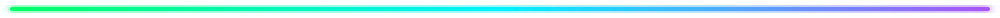

<!-- ป้ายไฟนีออนวิ่งรอบเส้นขอบด้านบนสุด -->

  

 

<!-- ส่วนที่ 1: ยอดคนเข้าชมโปรไฟล์ (Profile Views) -->

  

 

<!-- ส่วนที่ 2: GitHub Metrics (ซ้าย-ขวา) -->

  
  

<!-- เส้นไฟนีออนเรืองแสงวิ่งสลับสีเอง (คั่นโซนที่ 1) -->

  

 

<!-- ส่วนที่ 3: สถิติและทักษะ (ปรับเปลี่ยนมาใช้ตัวเลือกที่เสถียรกว่าและเข้ากับธีม Neon/Dark) -->

  <!-- กล่องที่ 1: GitHub Trophies -->
  
  
    

  <!-- กล่องที่ 2: Activity Graph (กราฟเส้น นีออนสีม่วง-เขียว) -->
  
  
    
  
  <!-- กล่องที่ 3: Skill Icons (แสดงทักษะภาษาและเครื่องมือ) -->
  

 

<!-- เส้นไฟนีออนเรืองแสงวิ่งสลับสีเอง (คั่นโซนที่ 2) -->

  

<!-- ส่วนที่ 4: อนิเมชันงูกินตาราง Commit -->

  <picture>
    <source media="(prefers-color-scheme: dark)" srcset="/dist/github-snake-dark.svg" />
    <source media="(prefers-color-scheme: light)" srcset="/dist/github-snake.svg" />
    
  </picture>

<!-- เส้นไฟนีออนเรืองแสงวิ่งสลับสีปิดท้ายด้านล่างสุด -->

  

